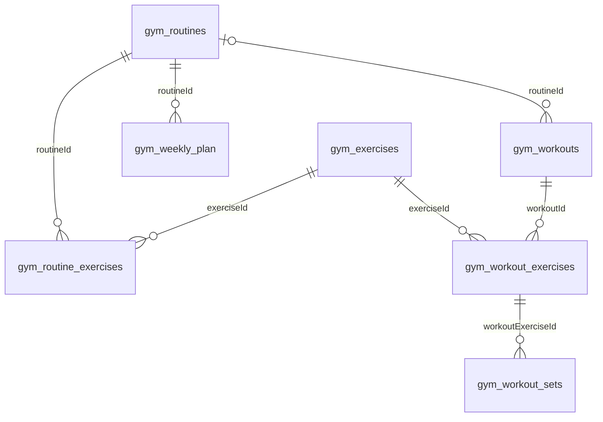

# Gym Tracker schema

Migrations: [`20261108120000_gym_tracker.sql`](../../supabase/migrations/20261108120000_gym_tracker.sql), [`20261109120000_gym_exercises_weight_unit.sql`](../../supabase/migrations/20261109120000_gym_exercises_weight_unit.sql).

| Table | What it holds |
|---|---|
| `gym_exercises` | Reusable exercise: name, `primaryMuscles` / `secondaryMuscles` (`text[]`), `equipment`, `loadType` (`weight` = pounds, `discs` = stack plates), `weightUnit` (`lb` default or `kg`: the unit a weight exercise is logged and shown in), notes, `imagePaths` in Storage. |
| `gym_routines` | A reusable training day (e.g. *Push*). |
| `gym_routine_exercises` | Ordered (`position`) planned lines: `sets`, `reps`, optional `load`. |
| `gym_weekly_plan` | `weekday` 1 (Monday) .. 7 → routine. No row = rest day. PK (`userId`, `weekday`). |
| `gym_workouts` | A logged day: `date`, title, notes, `finishedAt` (null = in progress), optional `routineId` it started from. |
| `gym_workout_exercises` | Ordered exercises of a workout, with the plan snapshot (`plannedSets`, `plannedReps`, `plannedLoad`; null when added ad hoc). |
| `gym_workout_sets` | Ordered sets: `reps`, `load`, `completed`. Only completed sets count in stats. |

- Every table has `"userId"` and the same four RLS policies (`auth.uid() = "userId"`); `anon` has no access.
- Child rows reference their parent and exercise through (`id`, `"userId"`), so a row cannot point at another user's data.
- `gym_exercises`, `gym_routines` and `gym_workouts` are soft-deleted (`deletedAt`). Workout history keeps pointing at deleted exercises.
- `load` is numeric: pounds for `loadType = 'weight'` (whatever `weightUnit` says; the app converts for display), a disc count for `'discs'`.

## RPCs

The app saves a routine or a workout with all its children in one transaction. Payloads use the app's JSON shape. Functions are `security invoker`, so RLS still applies; saving an id that belongs to another user raises `not found` (42501).

| Function | Does |
|---|---|
| `gym_save_routine(p_routine jsonb)` | Upserts the routine and replaces its `gym_routine_exercises`. |
| `gym_delete_routine(p_id uuid)` | Soft-deletes the routine and removes its weekly plan days. |
| `gym_save_workout(p_workout jsonb)` | Upserts the workout and replaces its exercises and sets. |

## Storage

Private bucket `gym-exercise-images` (10 MB, images only). Objects live under `<userId>/<uuid>.<ext>`; policies only allow a user to read and write their own folder.
